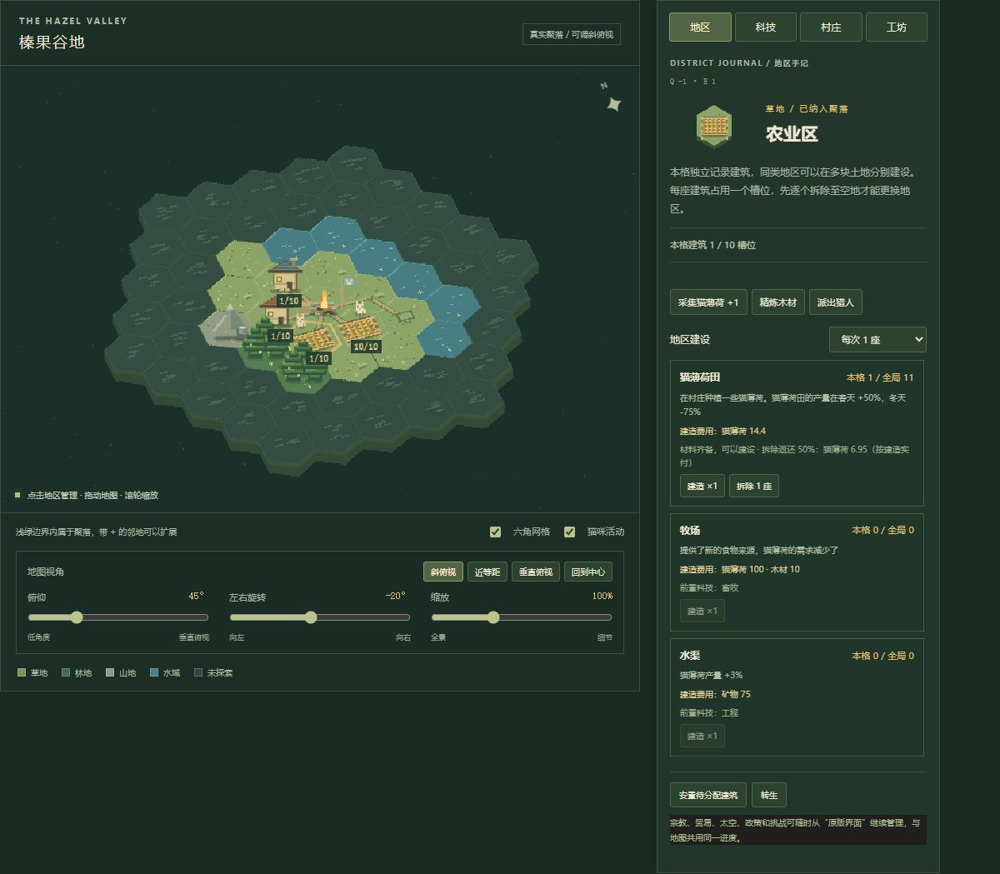

# 猫国地图版：使用与实现说明

本地首页现在就是可玩的六角地图。它读取并操作原版 Kittens Game 的同一个游戏实例，资源、费用、科技、季节、职业和生产公式继续由原版引擎负责。



## 1. 打开与继续旧进度

双击根目录 `start.cmd`，打开 `http://127.0.0.1:8765/`。已经运行的旧页面先保存，再刷新即可；请保持只有一个游戏窗口写入存档。

没有 `hexMap` 的旧存档第一次进入时，按已有建筑自动生成地区并连通聚落。旧建筑按每格容量拆分到合适地区；一万块农田超过当前地图容量的部分会放入“待安置建筑”，继续计入原版数量与产出。不会清掉旧建筑。新地块从零开始，需主动点“安置已有建筑 1 座”才会放入待安置建筑。

右上角「原版界面」可以随时打开原来的管理面板，再点「返回地图」回来。两种界面没有独立的进度。若地图无法加载，地址后加 `?view=classic` 可直接进入原版。

## 2. 从营火开始怎么玩

1. 点击中央营火，使用「采集猫薄荷 +1」积攒初始食物。
2. 进入农业区，建设猫薄荷田，让食物持续生产。
3. 在营火精炼木材，进入居住区建小屋。人口增长后会消耗口粮，建房前要留余粮。
4. 在学术区建图书馆，等猫咪到来后在「村庄」安排学者；查看顶部科学库存、容量和净产出。
5. 在「科技」研究日历、农业；农业开放农民后及时安排供粮，尤其要检查冬季的负产出。
6. 继续采矿、矿井、矿工、工坊、工具升级。图书馆和仓储分别解决科学容量与其他资源容量瓶颈。

顶部资源栏显示真实库存、容量与每秒净产出。粮食为负时会提示；春季的盈余不代表一定能过冬。需要停下来分配岗位或规划地图时可点击「暂停」，完成后点「继续」。

## 3. 地图怎么操作

| 操作 | 用途 |
| --- | --- |
| 点击地块 | 查看地形、领地、地区和对应建筑 |
| 按住地图拖动 | 平移视野 |
| 在地图上滚轮 | 缩放，范围 60%～180% |
| 俯仰滑条 | 30°～90°，90°为垂直俯视 |
| 左右旋转滑条 | -180°～180° |
| 斜俯视 / 近等距 / 垂直俯视 | 快速切换视角预设 |
| 回到中心 | 复位平移与缩放 |
| 地图获得焦点后按方向键 | 按当前屏幕方向选择相邻六角格 |

地图目前是固定半径 4、共 61 格。新进度拥有中心及相邻 6 格，周围一圈已揭示；已有建筑迁移时会自动扩出所需空间。选择带 `+` 的相邻地块，点击「勘察并扩展到这里」纳入领地，并揭示附近地形。

这一版扩地免费。道路自动连接地区，只用于画面表达；猫咪是按真实人口数量限制的代表动画，没有逐只搬运物资的机制。季节跟随原游戏，不能用地图人为切换季节。

视角采用 2.5D：地面随相机变化，建筑与树木保持直立并按屏幕深度遮挡。素材是单面像素精灵，旋转不会展示建筑真实背面。

## 4. 规划地区与建设

空的领地可以在「地区规划（每格独立）」选择地区，点击「设为此类地区」。同类地区可以规划多格，分别记录建筑与建造成本；新地块从 0 座开始，已有地区保持原位。每格默认 10 个建筑槽位，同格不同建筑共享容量，例如 10 块农田，或 8 块农田加 2 座牧场。

| 地区 | 主要内容 | 地形 |
| --- | --- | --- |
| 农业 | 田、牧场、水渠 | 草地 |
| 居住 | 小屋、木屋、宅邸 | 草地 |
| 学术 | 图书馆、学院、天文台、生物实验室、AI 核心 | 草地 |
| 林业 | 伐木工、锯木厂 | 林地 |
| 矿业 | 矿井、采石场 | 山地 |
| 仓储 | 粮仓、仓库 | 草地 |
| 工业 | 工坊、冶炼厂、煅烧炉、蒸汽工坊、工厂等 | 草地或山地 |
| 宗教 / 文化 / 贸易 | 寺庙、圆形剧场、贸易站等 | 草地 |
| 沿岸 | 港口 | 水陆相邻的草地或水域 |
| 能源 | 磁电机、反应堆，以及升级后的太阳能/水电设施 | 草地或山地 |
| 时间 | 时间相关建筑 | 草地 |
| 综合 | 其余原版建筑 | 草地 |

已有建筑的地块不能直接改类型或清除规划。需要先使用「拆除 1 座」逐个拆空，再点「清除空地区规划」或换地区。规划新地区不再移动其他地块。

实际建设在选中地块的建筑卡片完成，按原版解锁条件和全局价格扣费。批量可选 1 座或最多 10 座，同时受本格剩余槽位限制；只剩 1 个空位时，批量也只会建 1 座。新地块的数量从零开始，建造价格仍随全局同类建筑数量变化。

拆除每次减少选中地块的 1 座建筑、同步全局数量，并释放 1 个槽位。按该格该类建筑最近一座的实际建造成本返还 50%，卡片会提前显示返还物资；后续价格或折扣变化不改动已记录成本。仓储上限可能限制实际入库，完成提示显示实际入库数量。返还比例和各地区容量均可在 `game/map/config.js` 修改，见[地块容量与拆除配置](地块容量与拆除配置.md)。

旧存量缺少历史成交信息，会明确标注“旧存量估算”，使用原版当前公式估算最后一座的成本。同格按后建先拆处理，新建且记录成本的建筑先拆。拆除不使用原版按当前价格计算的撤销，若要恢复进度请使用已有存档备份。

超出地图容量的待安置建筑继续产生原版收益。选中同类地区可逐座安置，或用「安置待分配建筑」填入当前已有地区的空位；这些操作不移动现有建筑，也不创建新建筑或扣除资源。未放入地块的建筑也可以逐座拆除。

原版界面与地图建造共用容量检查与成本记录。原版普通出售同样按单座处理；因为原版出售没有地块选择器，会从同类建筑的最后一个有存量地块开始，地图上可精确选择要拆的地块。设施启停仍是全局开关，界面会注明“全局”。建筑阶段切换在原版界面进行，沿用原版全局转换规则。

规划地区不等于解锁建筑。先研究科技，再到对应地区建设；没有建筑的预留地区会显示规划标记。

## 5. 科技目标与分工

顶部默认按发展路线推荐下一项科技；也可以从下拉框指定远期目标。系统读取原版科技的前置解锁关系，向前找到当前应研究的节点，显示目标路径。

「查看下一步」会打开科技列表，容量不足时引导到学术或仓储区。提示的缺口是当前还差的数量；科技费用本身仍显示在研究卡片上。该建议是通用路线，不会自动替你分配猫咪或购买。

「科技」可筛选已开放、全部和已研究；「村庄」用 `− 1` 释放旧岗位，再用 `+ 1` 安排新岗位；「工坊」提供材料合成和效率升级，使用真实配方与工坊加成。

宗教仪式、贸易、太空探索、政策、工程师配方分配、挑战与其他高级操作仍从「原版界面」管理；对应的地面建筑与数量会同步回地图。详细发展策略继续参考[科技树发展路线](科技树发展路线.md)和[玩法攻略](玩法攻略.md)。

## 6. 存档、备份与恢复

顶部「保存并备份」把经济与地图一起写入硬盘。「存档管理」继续支持导出、导入和历史恢复；地图布局、探索状态、相机与科技目标随同一份快照恢复。

地图顶部「自动存档」下拉框可选择 5 秒、15 秒、30 秒、1 分钟、2 分钟、5 分钟或 10 分钟，默认 15 秒。选择后立即重新计时，刷新和重启浏览器后仍沿用此浏览器的选择；原版界面可在「存档管理」里修改同一设置。定期存档按实际时间执行，游戏暂停时也生效。地图操作随下次定期保存写入；手动保存、切到后台和退出页面仍会额外尝试保存。历史自动快照的每分钟频率与多窗口冲突保护保持原有规则。

存档额外字段为 `hexMap`：

```text
version: 2（地形仍沿用固定地图）
tiles: [{ q, r, owned, explored, district, lots }, ...]
// lots: { 建筑ID: [{ count, stage, prices: [{name, val}, ...] 或 null }, ...] }
reserve: { 建筑ID: [尚未安置的批次, ...] }
camera: { elevation, azimuth, zoom, panX, panY }
goal: 科技内部 ID 或 null
```

原版建筑数量继续负责生产；地图记录各地块分配数量与每座建造成本，地块合计加待安置数量始终与原版数量同步。没有地图字段或 `hexMap.version=1` 的存档会自动迁移为版本 2。官方原版另存可能移除地图字段和成本历史，再带回后会重新布局并按旧存量估算。

转生和删档继续使用原有本地备份保护，并按原版新进度生成地图。纯画风 Demo 独立运行、刷新还原，不读写正式进度。

## 7. 内容和代码在哪里

| 文件 | 职责 |
| --- | --- |
| `game/map/config.js` | 每格容量、各地区容量覆盖与拆除返还比例 |
| `game/map/state.js` | 独立地块、容量、成本批次、待安置存量、迁移、领地与地图存档 |
| `game/map/bridge.js` | 原版建筑/科技购买、工作、合成、采集、狩猎、开关与存档适配 |
| `game/map/app.js` | 主界面、真实资源展示、操作卡片和科技目标路线 |
| `game/map/shell.html`、`style.css` | 界面结构、样式和小窗口布局 |
| `game/hex-demo/world.js` | 固定地图、六角坐标、投影与选格 |
| `game/hex-demo/demo.js` | 共享 Canvas 像素绘图、精灵、季节、镜头和平移缩放 |
| `game/index.html` | 引擎就绪事件与地图脚本接入 |
| `game/local-client.js` | 原有磁盘存档同步，新增地图可调用的保存/可写状态入口 |

修改地区与地形去 `state.js`；修改通用科技推荐顺序去 `app.js` 的 `priority`。**修改价格、产量、科技内容仍去原版数据和管理器**，详见[项目结构与数值修改说明](项目结构与数值修改说明.md)。

根目录 `npm test` 验证存档服务、坐标投影和地图迁移；`npm run test:game` 在原版测试环境中验证真实购买、解锁、分工、合成与地图存档，同时运行原有回归用例。浏览器试玩使用独立临时存档目录，避免用正式进度测试购买与恢复。
