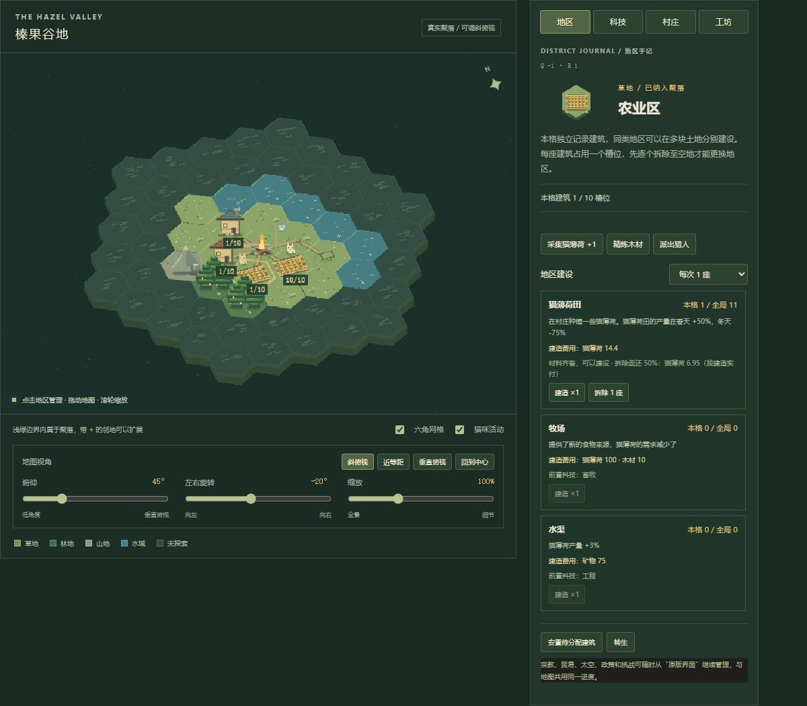

# 独立地块、容量与拆除参数

刷新游戏后启用。农业、居住、林业、矿业、学术、宗教、工业、沿岸及其他地区均支持同类多格，每格独立记录建筑。



## 调整参数

修改 `game/map/config.js`，保存后刷新游戏：

```js
demolitionRefundRatio: 0.5,
defaultTileCapacity: 10,
districtCapacities: {
  agriculture: 10, housing: 10, forestry: 10, mining: 10,
  science: 10, religion: 10, industry: 10, port: 10
}
```

- `demolitionRefundRatio`：拆除返还比例，范围 0～1。`0.5` 返还 50%，`0.25` 返还 25%，`0` 不返还。无效值回退为 50%。
- `defaultTileCapacity`：没有单独设置的地区默认槽位，必须是正整数。
- `districtCapacities`：按地区覆盖容量。例如把 `agriculture` 改为 `20`，每个农业地块就可放 20 座建筑。条目优先于默认值；要让某地区使用默认值，可删除该地区的覆盖条目。

一个槽位容纳一座建筑，同格不同类型共享槽位。农田、牧场和水渠都属于农业区；默认可以放 10 块农田，或 8 块农田加 2 座牧场。降低容量时，超出的存量移入待安置列表，数量和成本记录会保留。

## 新地块与拆除

在新的空地规划农业区后，该格从 0/10 开始，已有农业区继续保留原位和数量。批量建设会受剩余槽位限制，不能通过批量或原版普通建设绕过容量。建设价格仍用原版全局数量公式。

「拆除 1 座」每次只拆选中地块的一座建筑，并按后建先拆顺序返还。每次建设时记录实际支付的每种物资，拆除用该记录乘返还比例；不会用另一地块较贵的建筑成本代替，也不随后来的科技折扣重新定价。返还使用原版资源入库规则，受仓储上限影响，完成提示显示实际入库数。

地块有建筑时禁止覆盖规划。拆空后可清除地区类型或更换类型；地块本身仍属于领地。拆除后会清除原版当前价格撤销记录，避免与历史成本规则冲突；需要恢复时使用磁盘备份。

设施开关目前仍控制原版同类建筑的全局开启数量，按钮标明“全局”。原版建筑阶段转换也影响全部同类建筑，仍从原版界面操作。

## 旧存档

`hexMap.version=1` 或没有地图字段的旧存档会自动迁移为版本 2。旧布局优先保留，建筑按容量分配到合适地块；当前固定地图放不下的部分进入待安置列表，继续保留原版数量与产出。

新规划的地块始终从 0 座开始。待安置建筑只有在主动点击「安置已有建筑 1 座」或「安置待分配建筑」时才填入空位。待安置建筑也可逐座拆除。安置免费，不再购买，不改变全局总量。

旧存档没有逐座历史成交价，无法恢复当时折扣或挑战条件，因此卡片标记“旧存量估算”，使用原版当前公式估算上一座成本后乘返还比例。新建建筑会保存准确成本，包括从原版普通建设入口建造的建筑。旧成本估算和已记录实付会在界面中区分。

版本 2 的 `tiles[].lots` 保存本格各建筑的数量批次、阶段与单座成本；`reserve` 保存待安置批次。经济总量依然以原版 `buildings` 为准，同步时保证地块加待安置总量与原版一致。地图与成本记录随正常自动保存、手动备份、导出和恢复一起处理。
