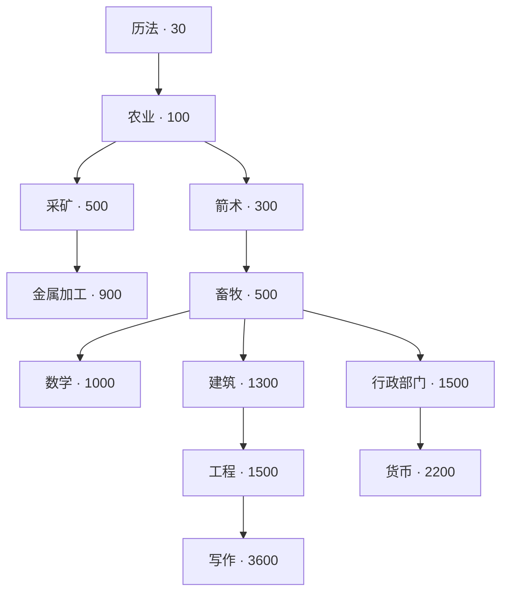
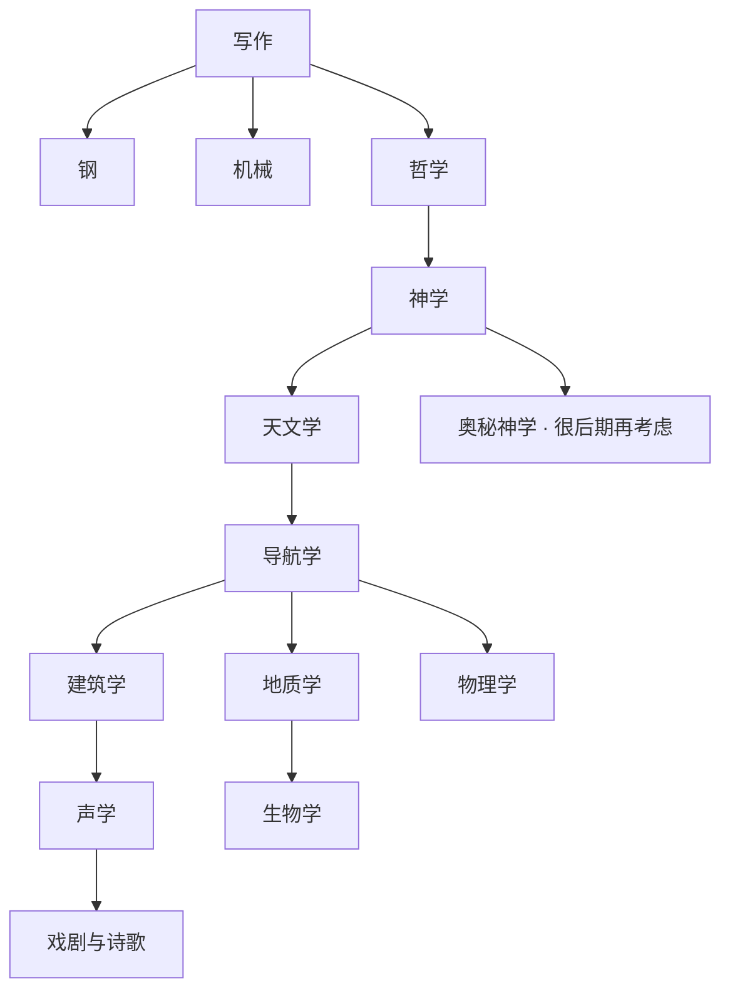
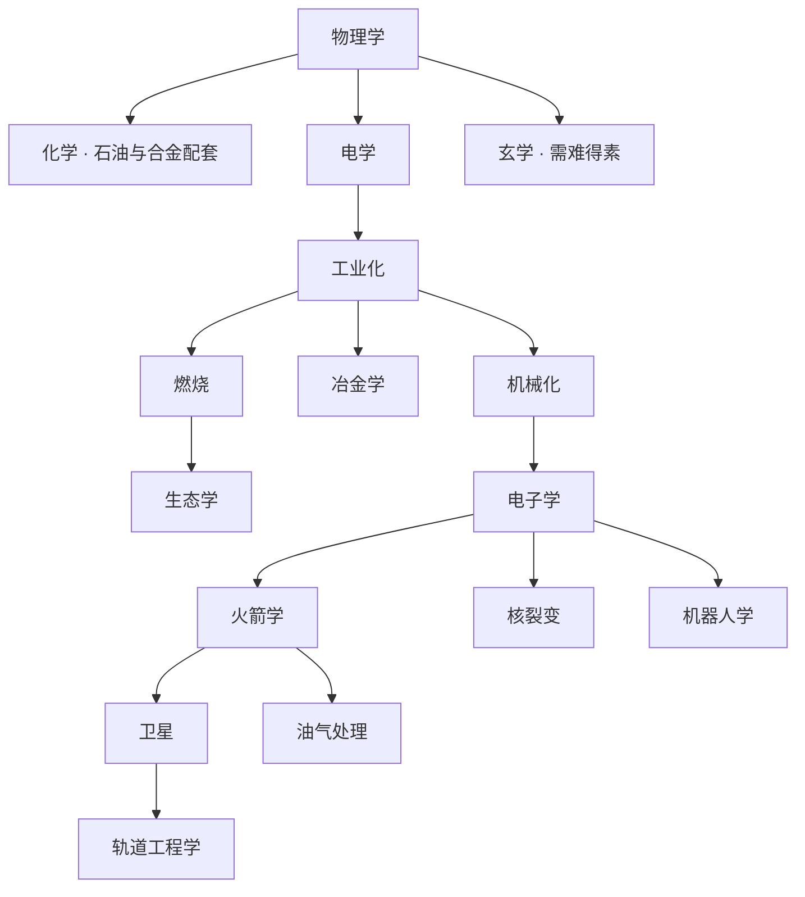

# 科技树发展路线：下一项该研究什么

适用版本：本地 Kittens Game **1.6.1.11**，普通开局。本文的前置关系和费用来自本地源码；优先级是方便新手推进的建议，挑战和多周目可以调整。

**只想知道现在怎么点：先看第 1 节，找到你最近研究过的科技，再按第 3～6 节推进。** 完整费用和直接前置另放在 [科技树完整索引](科技树完整索引.md)，不必一开始全部看完。

## 1. 新手先照这条路线走

下面表示建议的研究顺序，不代表每一项都是下一项的直接前置。途中缺粮就先补农民和粮食，容量不够就先扩容量。

| 阶段 | 建议顺序 | 本阶段只盯住这个目标 |
| --- | --- | --- |
| 吃饭与开工 | **历法 → 农业 → 采矿** | 能养猫，有木材和矿物来源，开始使用工坊 |
| 扩张基础 | **箭术 → 畜牧 → 数学 → 建筑** | 能狩猎、扩科学容量，获得更实用的住房和仓储 |
| 材料与写作 | **补金属加工 → 工程 → 写作** | 稳定产铁，建立文化和文献材料链 |
| 钢与黄金 | **钢；行政部门 → 货币** | 建立煤和钢供应，补黄金来源与贸易相关设施 |
| 科学通往航海 | **哲学 → 神学 → 天文学 → 导航学** | 科学容量、文献和星图跟得上，开始造船 |
| 工业通往太空 | **物理学 → 补化学 → 电学 → 工业化 → 机械化 → 电子学 → 火箭学** | 蓝图、石油、合金和工业产能能支撑太空计划 |

“补某科技”表示它来自另一条分支，若已经研究就跳过。特别是化学，它与电学同由物理学开放；它是准备石油和合金的重要配套，不是电学的科技前置。

食物紧张时，“农业后先箭术→畜牧”也可以；需要先把木材和矿物经济搭起来时，按表先采矿。**这两条早期分支最终都要发展，不是在选一个永久阵营。**

## 2. 先分清三件事

| 你点击的东西 | 它通常做什么 | 例子 |
| --- | --- | --- |
| 科学里的科技 | 开放新建筑、职业、配方或下一层研究 | 采矿开放矿井和工坊 |
| 营火里的建筑 | 实际提供容量、产出或倍率 | 建矿井后才能进一步使用对应职业解锁 |
| 工坊里的升级 | 强化已有生产方式或开放转换能力 | 斧头提高伐木效率，深度采矿与煤生产有关 |

所以研究完成后，接着检查“新建筑 → 职业分工 → 工坊升级”。只点科技，经济往往不会自动变强。

普通科技的两条分支通常可以都研究。**政策**是另一类选择，其中有互斥项目；看到政策确认框时，应单独阅读效果和冲突说明。

## 3. 第一张图：开局到写作

图中实线箭头表示直接开放的后续科技，不表示建议购买顺序。节点里的数字是基础科学费用；领袖、挑战等可能改变实际费用。

如果阅读器不显示图，按这四条关系看也一样：

- 历法 → 农业 → 采矿 → 金属加工。
- 农业 → 箭术 → 畜牧 → 数学。
- 畜牧 → 建筑 → 工程 → 写作。
- 畜牧 → 行政部门 → 货币。

### 研究完以后做什么

| 刚研究的科技 | 接下来真正要做的事 | 什么时候值得优先 |
| --- | --- | --- |
| 历法 | 朝农业推进，保持学者生产科学 | 开局主线 |
| 农业 | 调整农民，按需要建谷仓；给冬天留余量 | 缺粮、新人口快把食物吃空时 |
| 采矿 | 积木材建矿井，安排矿工，攒材料建工坊 | 矿物和工具经济还没建立时 |
| 箭术 | 安排猎人生产猫力，发动狩猎 | 想取得毛皮等资源，或要通向畜牧时 |
| 畜牧 | 按粮食压力考虑牧场，再选数学或建筑 | 需要降低耗粮、开始系统扩张时 |
| 数学 | 建学院，配合图书馆扩科学容量 | 下一项科技的科学费用超过容量时 |
| 建筑 | 看木屋、仓库、锯木厂；检查高级精炼等工坊升级 | 住房贵、木材慢、仓储不足时 |
| 金属加工 | 建冶炼厂，保证木材与矿物投入；考虑勘探等升级 | 后续建筑或工具开始要铁时 |
| 工程 | 需要时建水渠，提高粮食供给；继续写作 | 要通往写作，或有食物压力时 |
| 写作 | 看圆形剧场、羊皮纸和人口登记；开始准备文化与文献 | 前期经济基本站稳后 |
| 行政部门、货币 | 按目标建设贸易相关设施，检查金矿相关升级 | 开始缺黄金或需要交易配套时 |

**第一个容易卡住的点是科学容量。** 初始科学容量有限，图书馆、学院等需要穿插建设。科技要 1300 科学，而你只能存 1000 时，继续等不会攒到 1300。

工坊基础造价是 100 木材和 400 矿物。刚点采矿还建不起工坊很正常，先把矿井、工人和原料供应做出来。

## 4. 第二张图：写作之后，先打通航海

这一步建议用“先能生产、再能研究下一层”的节奏推进：

| 科技 | 基础费用 | 研究目的与配套动作 |
| --- | --- | --- |
| 钢 | 12000 科学 | 开放钢配方和深度采矿、煤炉等升级；选择合适升级建立煤来源，再合成钢 |
| 机械 | 15000 科学 | 开放蒸汽工坊及自动化、印刷相关升级；有明确自动化需求和材料时再投入 |
| 哲学 | 9500 科学 | 开放寺庙、概要配方，并通向神学；同时准备黄金、文化和手稿 |
| 神学 | 20000 科学 + 35 手稿 | 开放祭司，改善寺庙的信仰生产，并通往天文学 |
| 天文学 | 28000 科学 + 65 手稿 | 建天文台，改善科学容量与观测条件，继续积星图 |
| 导航学 | 35000 科学 + 100 手稿 | 开放船只配方与港口；开始积船，为贸易和容量发展做准备 |

默认建议先把钢和基础原料做稳，再往哲学→神学→天文学推进。若研究哲学已经很轻松，也可以同时开始宗教和文献准备，不用等所有工业升级买齐。

### 这时最常见的三个误区

**“哲学点了，怎么信仰还不涨？”** 普通寺庙的基础信仰产出要等神学研究后才生效。哲学让你能建设寺庙和继续研究，不等于信仰经济已自动建成。

**“神学明明科学够了，还是点不了？”** 它还要手稿。准备狩猎毛皮→羊皮纸，文化与羊皮纸→手稿。工坊里还需要实际合成这些材料。

**“同一层里奥秘神学最显眼，要先冲吗？”** 普通初次游玩可以暂缓。它要 650000 科学和 5 遗物，和神学后的天文学不是同一投入级别。先走能改善当前经济的天文学→导航学。

### 导航学后的三个选择

| 你现在需要什么 | 往哪点 | 原因 |
| --- | --- | --- |
| 更高级工业、蓝图合成入口 | **物理学** | 后面通向化学、电学和工业化 |
| 更强住房、铸币相关设施 | **建筑学** | 开放宅邸与铸币厂；它不是前期的“建筑” |
| 地质学家、采石场及后续生物学 | **地质学** | 改善相关资源供应，另开科研分支 |

默认以物理学为下一大目标；住房或资源供应明显卡住时，先补相应分支。

## 5. 第三张图：从物理学到火箭

### 推荐按这张表推进

| 目标 | 科技与基础费用 | 研究后要落实的建设 |
| --- | --- | --- |
| 能自制蓝图 | **物理学：50000 科学 + 35 概要** | 建立概要和蓝图合成；也可通过交易取得蓝图 |
| 获得石油、合金相关生产能力 | **化学：60000 科学 + 50 概要** | 看油井、煅烧炉、合金配方，核对投入原料 |
| 通往工业化 | **电学：75000 科学 + 85 概要** | 看磁电机及其供给需求，准备下一项研究材料 |
| 打开高级工业分支 | **工业化：100000 科学 + 25 蓝图** | 按实际瓶颈选择机械化、冶金学或燃烧 |
| 工厂和通往电子学 | **机械化：115000 科学 + 45 蓝图** | 建工厂，准备混凝土及更高加工效率 |
| 向太空开放道路 | **电子学：135000 科学 + 70 蓝图** | 检查微芯片、相关升级和建筑阶段，准备火箭学材料 |
| 开放太空页签 | **火箭学：175000 科学 + 125 蓝图** | 在太空页签筹备轨道发射，不能只点科技就完成发射 |

“机械化”是通往电子学的直接前置；“机械”是写作后的另一项科技。它们名字像，位置和目的不同。

研究火箭学以后，首次轨道发射的基础费用还包括 **15000 石油、5000 猫力、100000 科学、250 星图**。因此油井、仓储和猫力容量要提前准备。

### 工业化后的分支怎么选

- 想继续冲电子学、火箭学：先走 **机械化**。
- 采矿、冶炼等生产能力卡住：查看 **冶金学** 及其工坊升级。
- 需要燃料和石油相关升级，或准备太阳能农场：查看 **燃烧→生态学**。
- 不必只为了“把这一层清空”，买完所有分支再往前走。

## 6. 已经到电子学以后，方向怎么定

| 近期目标 | 科技方向 | 配套检查 |
| --- | --- | --- |
| 探索太空 | 火箭学 → 卫星 → 轨道工程学 | 石油、星图、猫力、科学容量和太空任务费用 |
| 更远的行星任务 | 火箭学 → 油气处理 | 煤油配方和持续石油供应 |
| 能源与核工业 | 核裂变 | 铀来源、反应堆开启数量和供给 |
| 自动加工、水力发电相关阶段 | 机器人学 | 工厂与原料供应；更换建筑阶段前看清会替代什么 |
| 太空制造等长期增益 | 核裂变 → 纳米技术 → 超导体 | 对应工坊升级是否已经有材料购买 |
| 时间领域与资源保留 | 核裂变 → 粒子物理学 → 时间物理学 | 时间水晶；时间物理学要 250000 科学 + 5 时间水晶 |
| 更高阶太空材料 | 轨道工程学 → 天文地质学 → 高等太空地质学 | 行星设施、难得素和对应生产链 |

第一次游玩到这里，只选一项近期目标即可。时间、人工智能、奥秘神学等可以留作后续目标，不必同时铺开所有高阶系统。

## 7. 按症状选方向：卡住时看这一张

| 当前情况 | 优先行动 | 暂时可以放后的内容 |
| --- | --- | --- |
| 快饿死、过不了冬 | 农业后的农民、谷仓；畜牧后的牧场；工程后的水渠 | 当前没有收益的高阶科研 |
| 科学费用比容量还高 | 图书馆；数学后的学院；天文学后的天文台 | 继续攒当前存不下的科学 |
| 木材很慢 | 采矿后的工坊斧头；建筑后的锯木厂；检查伐木工 | 与木材瓶颈无关的支线 |
| 想造设施，但没有铁 | 金属加工→冶炼厂，并保证木材和矿物投入 | 只增加耗铁目标 |
| 有铁但没有煤、钢 | 钢科技及相关工坊升级，建立煤来源 | 依赖大量钢的扩张 |
| 缺手稿、概要 | 狩猎、文化、羊皮纸与手稿；哲学开放概要 | 继续囤暂时用不掉的科学 |
| 缺黄金 | 货币相关的金矿升级、已有交易途径 | 急着堆需要黄金的设施 |
| 想改善钛贸易 | 导航学后的船只、贸易原料和容量 | 船只和原料都不足时大量赌交易 |
| 太空任务的石油存不下 | 化学后的油井、容量及相关升级 | 只研究更多新太空科技 |
| 研究完看不出变化 | 检查新建筑、职业、工坊升级和配方 | 继续盲点下一项 |

## 8. 看名字最容易点错的几组

| 名字 | 所在阶段 | 区别 |
| --- | --- | --- |
| 建筑 / 建筑学 | 前期 / 导航学之后 | 前者开木屋、仓库、锯木厂；后者开宅邸、铸币厂 |
| 机械 / 机械化 | 写作之后 / 工业化之后 | 前者偏蒸汽与自动化升级；后者开工厂并通向电子学 |
| 金属加工 / 冶金学 | 采矿之后 / 工业化之后 | 前者开冶炼厂；后者开放更高级冶炼和采矿升级 |
| 神学 / 奥秘神学 | 中期 / 高阶长期发展 | 先用神学打通天文学，不必刚看到奥秘神学就去冲它 |
| 地质学 / 天文地质学 | 导航学之后 / 轨道工程学之后 | 前者是地质学家等地面资源体系，后者关联太空材料升级 |

## 9. 每次研究前后，只做这几步

研究前：先确定近期目标 → 找到能解决它的科技 → 看完整费用和资源容量。

研究后：看新建筑 → 看新职业 → 看工坊升级或配方 → 实际建造、分工和生产 → 再决定下一项科技。

例如目标是“增加人口”，可按 **畜牧→建筑→木屋** 考虑，但还要有矿物、木材和食物；目标是“继续研究更高级科技”，则可能先补 **数学→学院**。把科技和它后面的建设连起来，方向就会清楚很多。

## 10. 如何使用完整索引与核对源码

[科技树完整索引](科技树完整索引.md) 列出当前科技的中文名、内部标识、基础费用、直接前置与后续。它适合查“这项从哪里来”，不表示必须把一整层都研究完。

本文以 [science.js](../game/js/science.js) 的科技定义为主，同时核对了 [buildings.js](../game/js/buildings.js)、[workshop.js](../game/js/workshop.js)、[space.js](../game/js/space.js) 和中文翻译。需要一般经营建议时，可以配合 [玩法攻略](玩法攻略.md) 阅读。
