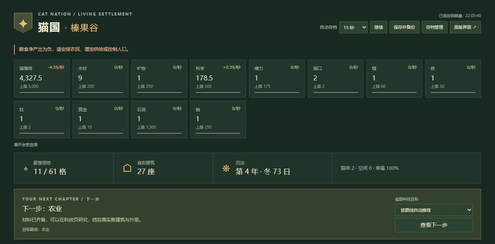

# 试玩与修复记录

日期：2026-11-07。测试使用独立临时目录和本机测试端口，正式存档只读取副本，没有在正式进度上执行建造、转生或恢复。

## 修复的问题

| 问题 | 复现与影响 | 修复 |
| --- | --- | --- |
| 满地块导致自动建造订单丢失 | 农业区有 10 座农田，再把农田加入原版队列：没有建成、没有扣费，但队列却把订单当作完成移除 | 建造入口返回真实结果，容量不足时保留订单；新增地区后正常继续。原版满地块建造按钮也会禁用 |
| 队列可以绕过建筑解锁 | 给尚未解锁的冶炼厂排队，若资源和地块满足，原版购买入口没有检查建筑解锁 | 地面建筑统一检查解锁条件；前置科技未完成时等待，开放后继续，资源不提前扣除 |
| 转生存档错误保留旧地图 | 转生生成新经济存档时，地图保存钩子仍读取旧局状态，带入旧领地、地区、目标和建筑成本记录 | 转生保存阶段根据新存档生成初始地图，同时保留当前局对象，避免生成存档时污染原局；普通保存与备份恢复继续使用原布局 |
| 资源增多后科学被折叠 | 资源栏直接取原版顺序的前 12 项，科学可能排到其后，只能展开才能看到 | 常用资源优先显示，科学固定在前列；展开、收起时按同一顺序排列 |
| 少量人口时动画数量不一致 | 原来只判断人口是否大于零，然后固定绘制四只猫 | 动画数量为实际人口与 4 的较小值；零人口时不绘制，人数多时继续用代表动画 |
| 岗位已满仍显示可增加 | 有空闲猫时，岗位达到自身上限也会显示可点击的 `+ 1`，点击后才报错 | 增加岗位按钮同时检查空闲猫和原版岗位上限 |

核心修复在 `game/map/bridge.js`；资源与岗位界面在 `game/map/app.js`；猫咪绘制在 `game/hex-demo/demo.js`。

## 实际页面试玩

- 新存档：采集 10 次、支付 10 猫薄荷建设第一块田；积攒资源后批量建设到本格 10/10，满格继续点击不会多扣资源。
- 原版队列：满格时添加农田，运行后仍保留 1 个订单；另规划一格农业区后，自动建设 1 座，原格仍有 10 座，队列归零。拆除该座返还约 15.5 猫薄荷，释放新格槽位，原格数量保持不变。
- 进度副本：用真实库存精炼木材、建设图书馆，安排两只学者积累科学，研究历法和农业，再把一只学者改为农民。实际推进到了冬季，检查了季节变化、粮食负产出提示与岗位净产出更新。
- 转生与恢复：在测试副本上转生后，回到 7 格领地、0 座建筑；通过转生前的手动备份恢复后，27 座建筑、11 格领地和科技一起恢复。
- 多资源场景：只在测试服给额外资源少量库存，确认 17 种资源时科学仍出现在折叠栏；展开后显示全部，收起后保留常用的 12 项。
- 多窗口：两个页面写同一测试存档时，旧窗口保存被拒绝，并由运行状态自动暂停，当前窗口的磁盘进度保持有效。



## 自动验证

```text
npm test
7 项本地测试通过

npm run test:game -- --silent
5 个测试套件、61 项游戏测试通过
```

新增 `game/test/map-regressions.test.js`，在真实原版引擎状态上验证满格队列保留与恢复、队列解锁条件、转生地图清空和存档往返。原有保存冲突、历史成本返还、独立地块容量和原版回归测试继续通过。

本轮主要覆盖开局、地面经营、科研和本地存档流程。后期太空与全部挑战没有逐局完整试玩，当前只覆盖现有原版回归测试，不能据此认为所有后期组合均已验证。
